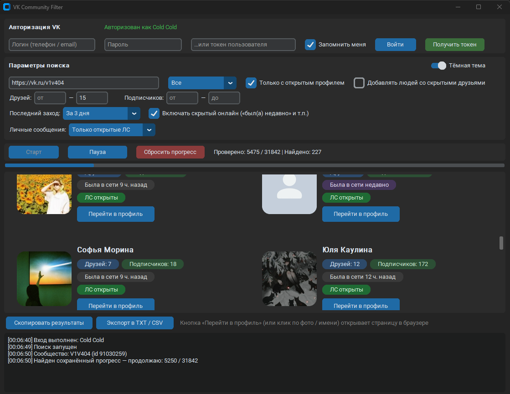

# VK Community Filter

Десктопное приложение для поиска и фильтрации участников сообществ ВКонтакте по заданным критериям. Проект разработан на Python с использованием современного графического интерфейса **CustomTkinter** и официальной библиотеки **vk_api**.

## 🖼 Интерфейс
> 
*(Сюда можно положить скриншот интерфейса с именем `screenshot.png` в корень репозитория)*

## 🚀 Основные возможности
* **Гибкая фильтрация:** поиск по полу, количеству друзей, числу подписчиков, статусу профиля (открытый/закрытый).
* **Фильтр по времени активности:** отбор пользователей по дате последнего визита («онлайн сейчас», «за последний час», «за 3 дня» и т.д.).
* **Проверка личных сообщений:** фильтрация по доступности отправки личных сообщений.
* **Многопоточность:** сетевые запросы к VK API выполняются в фоновых потоках, благодаря чему графический интерфейс не зависает во время парсинга.
* **Сохранение прогресса:** автоматическое сохранение текущей позиции парсера, что позволяет продолжить работу после перезапуска программы.
* **Экспорт данных:** возможность копирования результатов в буфер обмена или выгрузки в форматы **TXT / CSV**.

## 🛠 Технологии
* **Python 3.x**
* **CustomTkinter** (современный интерфейс с поддержкой тем)[cite: 9]
* **vk_api** (взаимодействие с API ВКонтакте)[cite: 9]
* **Pillow (PIL)** (обработка и скругление аватарок пользователей)

## 📦 Установка и запуск
1. Клонируйте репозиторий:
   ```bash
   git clone [https://github.com/leyylin/vk-community-filter.git](https://github.com/leyylin/vk-community-filter.git)
   cd vk-community-filter